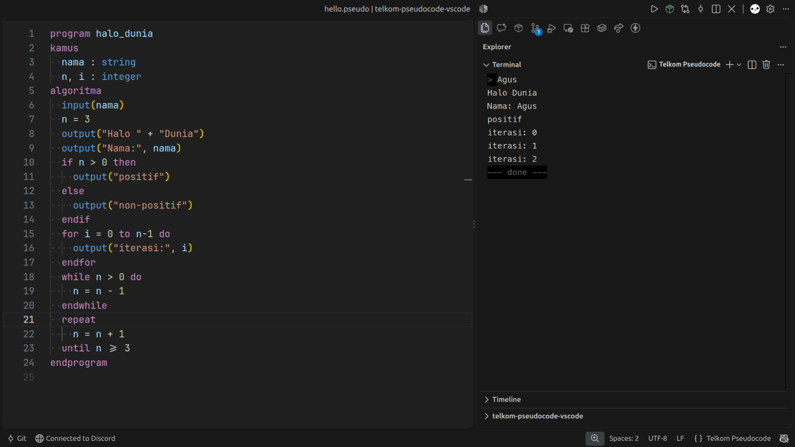

# Telkom Pseudocode for VS Code

Syntax highlighting, live checking, completion, rename and a runner for Telkom University pseudocode (`.pseudo`, `.tpseudo`).




## Features

- **Highlighting**: comments `{ }`, strings, chars, numbers, keywords, types, `NIL`, operators (`div/mod/and/or/not`, `==`, `->`, `&`, `*`, `..`), calls, type names, `->field`.
- **Editor support**: `{ }` comment toggle, bracket matching, indentation and folding for every block, snippets (`program`, `function`, `procedure`, `if`, `case`, `for`, `while`, `repeat`, `array`, `struct`, `sll`, `output`).
- **Live checking** (also `Telkom Pseudocode: Check File`), as you type:
  - syntax of every statement and declaration, unclosed blocks, misplaced `else` / `endif`;
  - undeclared names, unknown types, duplicate declarations, reserved words used as names;
  - **types**: wrong-type assignments, arguments and return values, non-boolean conditions, `integer / integer`, comparing structs or arrays, `.` on a pointer and `->` on a struct, wrong argument counts, assigning to a constant;
  - structure rules from the course: blank lines around `kamus` / `algoritma`, a blank line between units, procedure `I.S.` / `F.S.`, parameter modes, `<-`, `output("x" + number)`, `array[0..MAX]`, `for ... to n`;
  - variables that may be read before they are assigned, and declarations that are never used.
- **Run** (`Telkom Pseudocode: Run File`, the play button, or `Ctrl+F5`): the program runs in a terminal. Output appears as it is printed and `input(...)` waits for you to type a line. `Ctrl+C` stops a running program. Checker errors block the run; runtime errors print as `Runtime error at line N: message`.
- **Completion**: declared variables with their types, functions and procedures with their parameters, struct fields after `.` and `->` (through any chain: `p->next->`, `d[i].`, `((L.first)->next)->`), types inside `kamus`.
- **Rename** (`F2`): variables, constants, parameters, loop variables, type names, functions and procedures, with scope and shadowing respected.

## How programs run

- **Input** is separated by spaces and may be typed on one line or several: `input(a, b)` accepts `3 4` or `3`, Enter, `4`. A `string` that is the last variable of an `input(...)` takes the rest of its line, so `input(nama)` reads `Budi Santoso` whole.
- Every variable, pointers included, must be assigned before it is read (`p = NIL` to start a pointer empty).
- Coercions: `integer → real`, and `char → string` on assignment to a string variable. Nothing else converts.
- Assigning a struct copies it. Arrays cannot be assigned as a whole; they can be passed as parameters (copied for `in`, shared for `in/out`).
- Array bounds are constant expressions over declared constants: `array[0..MAX-1]`.
- Subprograms see the program's `kamus` variables and constants; their own `kamus` shadows them.
- A subrange `integer[0..100]` is enforced on assignment and input.
- `&x` prints as a hex address, stable within a run.
- A `for` loop that never runs still leaves its variable at the start value.
- Memory that is allocated and never deallocated prints a warning at the end.
- Limits: 1000 nested calls, 500000 steps (catches endless loops).
- `function` / `procedure` headers inside `kamus` (prototype style from some course material) are accepted and ignored; declare the subprogram itself outside the program block.
- Keywords are lowercase. `PROGRAM` or `Integer` is reported with the spelling to use.

## Rules not confirmed with a lecturer

These follow the course material as far as it goes; check with your lecturer.

- `s[i]` reads a `char`, which becomes a 1-character `string` when assigned to a string variable. `s[i] = "a"` writes; `s[i] = 'a'` is a type error. `"abc" + s[i]` is a type error (string `+` needs two strings).
- `integer / integer` is not allowed (use `div`); `real div real` is.
- `div` and `mod` both truncate toward zero: `-7 div 3 = -2`, `-7 mod 3 = -1`.
- `repeat` runs at least once and stops when its condition is true.

## Development

No dependencies and no build step.

```bash
npm run check
```

runs every check: grammar, checker, runner, completion, rename, extension wiring, and a robustness pass that feeds thousands of half-typed programs to all of them.

The language lives in `lang/` and does not import VS Code:

| File | Job |
|---|---|
| `lexer.js` | text → tokens; the one list of reserved words |
| `parser.js` | tokens → one syntax tree for the file; recovers at every line |
| `types.js` | what a type is and which types fit together |
| `analyzer.js` | tree → model: scopes, types, every diagnostic, every reference |
| `interpreter.js` | runs the analyzed tree |
| `run-worker.js`, `run-session.js` | run on a worker thread; terminal input and output |
| `completion.js`, `rename.js` | lookups into the model |

`extension.js` only connects these to VS Code. To try a change, press `F5` in VS Code to open an Extension Development Host and open a file from `samples/`.

## Package

```bash
npm i -g @vscode/vsce && vsce package
```
