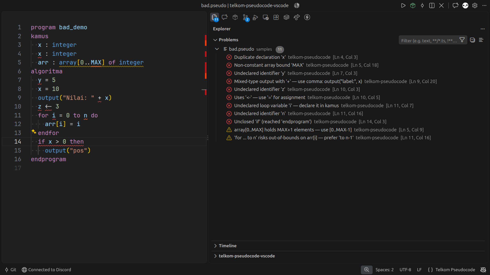

# Telkom Pseudocode

Everything for writing and running Telkom University pseudocode (`.pseudo`, `.tpseudo`) in one project:

- a **type checker** that catches syntax, name and type errors and the course's style rules;
- a **runner** that executes programs, with live output and `input(...)` read as it is needed;
- a **VS Code extension** with highlighting, snippets, live checking, completion, rename and a run button;
- a **command line**, `tpseudo`, that checks and runs files in any terminal;
- an **agent skill** that teaches AI assistants the format and has them verify their pseudocode with `tpseudo`.

The editor, the command line and the skill's checks share one checker and one runner (`lang/`), so a program behaves the same everywhere.




## Install

**VS Code extension**: install the `.vsix` from the [releases page](https://github.com/idanfath/telkom-pseudocode/releases) (Extensions view → `...` → *Install from VSIX...*).

**Command line**, pick one:

```bash
npm i -g telkom-pseudocode       # needs Node 18+; gives you tpseudo
npx telkom-pseudocode main.pseudo   # or run once without installing
```

or download a standalone `tpseudo` for Linux, Windows or macOS from the [releases page](https://github.com/idanfath/telkom-pseudocode/releases). It needs nothing else installed.

**Agent skill**, for AI assistants (see [Agent skill](#agent-skill)):

```bash
npx skills add idanfath/telkom-pseudocode                                  # Claude Code, Codex, Cursor and other agents
/plugin install telkom-pseudocode --marketplace idanfath/telkom-pseudocode  # inside Claude Code, as a plugin
```

On claude.ai, upload [`telkom-pseudocode-skill.zip`](https://github.com/idanfath/telkom-pseudocode/releases/latest/download/telkom-pseudocode-skill.zip) under Settings → Capabilities → Skills.

## Editor features

- **Highlighting**: comments `{ }`, strings, chars, numbers, keywords, types, `NIL`, operators (`div/mod/and/or/not`, `==`, `->`, `&`, `*`, `..`), calls, type names, `->field`.
- **Editor support**: `{ }` comment toggle, bracket matching, indentation and folding for every block, snippets (`program`, `function`, `procedure`, `if`, `case`, `for`, `while`, `repeat`, `array`, `struct`, `sll`, `output`).
- **Live checking** (also `Telkom Pseudocode: Check File`), as you type:
  - syntax of every statement and declaration, unclosed blocks, misplaced `else` / `endif`;
  - undeclared names, unknown types, duplicate declarations, reserved words used as names;
  - **types**: wrong-type assignments, arguments and return values, non-boolean conditions, `integer / integer`, comparing structs or arrays, `.` on a pointer and `->` on a struct, wrong argument counts, assigning to a constant;
  - structure rules from the course: no blank lines between `program` / `kamus` / `algoritma` / `endprogram`, a blank line between units, procedure `I.S.` / `F.S.`, parameter modes, `<-`, `output("x" + number)`, `array[0..MAX]`, `for ... to n`;
  - variables that may be read before they are assigned, and declarations that are never used.
- **Run** (`Telkom Pseudocode: Run File`, the play button, or `Ctrl+F5`): the program runs in a terminal. Output appears as it is printed and `input(...)` waits for you to type a line. `Ctrl+C` stops a running program. Checker errors block the run; runtime errors print as `Runtime error at line N: message`.
- **Completion**: declared variables with their types, functions and procedures with their parameters, struct fields after `.` and `->` (through any chain: `p->next->`, `d[i].`, `((L.first)->next)->`), types inside `kamus`.
- **Rename** (`F2`): variables, constants, parameters, loop variables, type names, functions and procedures, with scope and shadowing respected.

## How programs run

- **Input** is separated by spaces and may be typed on one line or several: `input(a, b)` accepts `3 4` or `3`, Enter, `4`. A `string` that is the last variable of an `input(...)` takes the rest of its line, so `input(nama)` reads `Budi Santoso` whole.
- Every variable, pointers included, must be assigned before it is read (`p = NIL` to start a pointer empty).
- Coercions: `integer → real`, and `char → string` on assignment to a string variable. Nothing else converts.
- Assigning a struct copies it. Arrays cannot be assigned as a whole; they can be passed as parameters (copied for `in`, shared for `in/out`).
- Array bounds are constant expressions over declared constants: `array[0..MAX-1]`.
- Subprograms see the program's `kamus` variables and constants; their own `kamus` shadows them.
- A subrange `integer[0..100]` is enforced on assignment and input.
- `&x` prints as a hex address, stable within a run.
- A `for` loop that never runs still leaves its variable at the start value.
- Memory that is allocated and never deallocated prints a warning at the end.
- Limits: 1000 nested calls, 500000 steps (catches endless loops).
- `function` / `procedure` headers inside `kamus` (prototype style from some course material) are accepted and ignored; declare the subprogram itself outside the program block.
- Keywords are lowercase. `PROGRAM` or `Integer` is reported with the spelling to use.

## Command line

`tpseudo` checks and runs files outside VS Code (see [Install](#install)).

```bash
tpseudo main.pseudo                 # check, then run; input() reads what you type
tpseudo main.pseudo < input.txt     # or reads from a file
tpseudo check a.pseudo b.pseudo     # errors and warnings, no run
```

Options: `--max-steps <n>` (0 = no limit), `--no-check` to run despite checker errors, `--no-color`. Errors are printed as `file:line:col: error: message` on stderr, program output on stdout.

Exit codes: `0` ok, `1` checker errors, `2` runtime error, `3` bad arguments or unreadable file, `130` stopped with `Ctrl+C`.

## Agent skill

[`skills/telkom-pseudocode/SKILL.md`](skills/telkom-pseudocode/SKILL.md) teaches an AI assistant the format: types, `kamus` declarations, control flow, functions and procedures, pointers, linked lists, and the common mistakes. It loads when you mention pseudocode, `kamus`, `algoritma` and similar, or ask to convert code to or from pseudocode.

After writing a whole program, function or procedure, the assistant runs `npx telkom-pseudocode check` (or `tpseudo check`) on it and fixes what the checker reports, so its answers pass the same checks as the editor. Without Node or network access it falls back to the written rules.

Every example in the skill is checked by `npm run check`, so the skill and the checker cannot drift apart unnoticed.

## Rules not confirmed with a lecturer

These follow the course material as far as it goes; check with your lecturer.

- `s[i]` reads a `char`, which becomes a 1-character `string` when assigned to a string variable. `s[i] = "a"` writes; `s[i] = 'a'` is a type error. `"abc" + s[i]` is a type error (string `+` needs two strings).
- `integer / integer` is not allowed (use `div`); `real div real` is.
- `div` and `mod` both truncate toward zero: `-7 div 3 = -2`, `-7 mod 3 = -1`.
- `repeat` runs at least once and stops when its condition is true.

## Development

No dependencies and no build step.

```bash
npm run check
```

runs every check: grammar, checker, runner, completion, rename, extension wiring, the command line, the skill's examples, and a robustness pass that feeds thousands of half-typed programs to all of them.

The language lives in `lang/` and does not import VS Code:

| File | Job |
|---|---|
| `lexer.js` | text → tokens; the one list of reserved words |
| `parser.js` | tokens → one syntax tree for the file; recovers at every line |
| `types.js` | what a type is and which types fit together |
| `analyzer.js` | tree → model: scopes, types, every diagnostic, every reference |
| `interpreter.js` | runs the analyzed tree |
| `run-worker.js`, `run-session.js` | run on a worker thread; terminal input and output |
| `completion.js`, `rename.js` | lookups into the model |

`bin/tpseudo.js` is the command line; it uses `lang/` directly. `skills/telkom-pseudocode/` is the agent skill and `.claude-plugin/` lists it as a Claude Code plugin.

Code blocks in `SKILL.md` are tagged for `scripts/check-skill.mjs`: ` ```pseudo ` must pass the checker, ` ```pseudo wrong ` must fail it, ` ```pseudo fragment ` is not checked, and ` ```pseudo kamus name=x ` / `uses=x` share declarations between blocks.

`extension.js` only connects these to VS Code. To try a change, press `F5` in VS Code to open an Extension Development Host and open a file from `samples/`.

From a clone, `npm link` puts your working copy's `tpseudo` on your PATH.

## Release

No compile step: everything is plain JavaScript with no dependencies. A release is four kinds of file:

```bash
npx @vscode/vsce package     # telkom-pseudocode-<version>.vsix: the editor extension
npm stage publish            # the command line on npm (bin/ and lang/ only, see .npmignore);
                             # then approve it with 2FA: npm stage approve <id>, or npmjs.com → Staged Packages
npm run build:bin            # dist/tpseudo-<platform>: standalone executables, needs Bun
npm run build:skill          # dist/telkom-pseudocode-skill.zip: the skill for claude.ai
```

`npm run build:bin linux-x64` builds one platform only. To check a built executable:

```bash
TPSEUDO_BIN=dist/tpseudo-linux-x64 node scripts/check-cli.mjs
```
